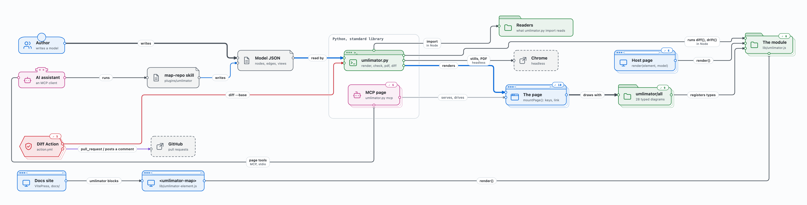

# umlimator
[](https://m8ven.ai/mcp/zintaen-umlimator-gzfncx?s=readme)
Layered architecture maps and 28 UML, SysML, C4, BPMN and cloud diagram types you can click through, from one JSON model.

[](https://github.com/zintaen/umlimator/actions/workflows/check.yml)
[](https://www.npmjs.com/package/umlimator)
[](https://www.npmjs.com/package/umlimator)
[](https://github.com/zintaen/umlimator/blob/main/LICENSE)
[](https://zintaen.github.io/umlimator/)
[](https://buymeacoffee.com/cyberskill)

One model drives an ES module with no dependencies, a CLI, a GitHub Action that posts what a pull request changes in your maps, and an MCP server for AI assistants. [Documentation](https://zintaen.github.io/umlimator/) | [Diagram types](https://zintaen.github.io/umlimator/types/) | [Atlases](https://zintaen.github.io/umlimator/atlas/) | [Playground](https://zintaen.github.io/umlimator/examples/playground.html) | [Changelog](https://zintaen.github.io/umlimator/changelog.html)

[](https://zintaen.github.io/umlimator/examples/umlimator-atlas.html)

## Install

| | |
|---|---|
| npm | `npm install umlimator` |
| CDN | `import { render } from 'https://cdn.jsdelivr.net/npm/umlimator@0.46.0/lib/umlimator.js'` |
| CLI | `git clone --depth 1 --branch v0.46.0 https://github.com/zintaen/umlimator.git` (Python 3.9+, Chrome for pictures) |
| GitHub Action | `uses: zintaen/umlimator@v0.46.0` |
| MCP | `claude mcp add umlimator -- python3 /path/to/umlimator.py mcp /path/to/model.json` |

Or from GitHub, at a tag or any commit: `"umlimator": "github:zintaen/umlimator#v0.46.0"`. npm 12 refuses git
dependencies unless the project opts in, so that also needs `allow-git=root` in the `.npmrc` next to `package.json`.

## Quick start

```js
import { render } from 'umlimator';   // one ES module, no dependencies, no build step
import 'umlimator/theme.css';         // the default --um-* palette and fonts (or set the variables yourself)

const map = render(document.getElementById('map'), model, {
  on: { select: e => showDetails(e.target), open: e => { e.preventDefault(); router.push(e.view); } },
});
map.update(nextModel);                        // redraws only what changed; keeps the view, camera and selection
const png = await map.toPNG({ view: 'api' }); // any view, without showing it
```

Or with no script of your own, `<umlimator-map src="model.json"></umlimator-map>`, or from the command line:

```bash
python3 umlimator.py render examples/umlimator-atlas.json --out page.html   # the interactive page, then its layout check
python3 umlimator.py stills page.html --out stills/                   # every view as SVG and PNG
```

[A first diagram](https://zintaen.github.io/umlimator/start/first-diagram.html) walks through a first model.

## What it does

- **Maps and drill-down**: a view per level (system, containers, components, flows); a stacked card opens its inner
  view, or unfolds in place. Automatic layout with orthogonal lines that never run through a card, the same picture for
  the same model, and a layout check.
- **28 diagram types**: UML's 14 and its information flow diagram, ER, flowchart, data flow, C4's six views, SysML v1.7's four, mindmaps, Google
  Cloud, Azure and AWS architecture diagrams and BPMN, each on [its own page](https://zintaen.github.io/umlimator/types/): a live example, how to write it, and what of its
  notation is drawn and left out.
- **Editing with `apply()`**: opt-in gestures emit events; the host decides, and `apply()` turns a typed diagram's
  `edit` into the next model, with undo.
- **Stories, lenses and live data**: step-by-step walk-throughs, saved ways to look at a map by team or data flow, and
  traffic, errors and OpenTelemetry traces drawn over it.
- **Diff and drift in pull requests**: what a change does to your maps, marked and in words, posted by a GitHub Action;
  rules that fail CI; the map against the traffic seen.
- **An AI assistant on the map**: an MCP server through which an assistant such as Claude Code reads the model and
  drives its page in your browser.
- **Import and export**: Structurizr, C4-PlantUML, Mermaid, DBML, BPMN XML, `docker compose` and `kubectl` JSON in;
  SVG, PNG, PDF, animated PNG and BPMN XML out.
- **Cloud icon packs**: Google Cloud, Azure and AWS service icons from packs you fetch yourself after reading the
  vendor's terms. The npm package and the repository ship none; the GitHub Pages site shows vendor icons fetched at its
  build. Umlimator is not affiliated with, endorsed by or sponsored by Amazon Web Services, Google or Microsoft.

## Documentation

| | |
|---|---|
| [Docs](https://zintaen.github.io/umlimator/) | the documentation site, one sidebar in reading order: Start, Diagrams, Maps and atlases, Use it, Reference ([as Markdown](https://github.com/zintaen/umlimator/tree/main/docs)) |
| [Start](https://zintaen.github.io/umlimator/start/install.html) | install, and [a first diagram](https://zintaen.github.io/umlimator/start/first-diagram.html) |
| [Diagram types](https://zintaen.github.io/umlimator/types/) | the 28 types, each on one page: a live example, how to write it, and what is drawn and left out |
| [Atlases](https://zintaen.github.io/umlimator/atlas/) | whole businesses, each one model in many views (each opens on a map: the [Bookshop atlas's overview](https://zintaen.github.io/umlimator/atlas/bookshop.html#view-overview) shows everything a map draws) |
| [Use it](https://zintaen.github.io/umlimator/use/cli.html) | the CLI, embedding, the standalone page, MCP, the GitHub Action, import and export, icon packs and editing, with [host pages](https://zintaen.github.io/umlimator/use/embedding.html#host-pages) for embedding, live updates and editing ([what each example shows](https://github.com/zintaen/umlimator/blob/main/examples/README.md)) |
| [API](https://zintaen.github.io/umlimator/api/) | every export, its options and events (`lib/umlimator.d.ts`) |
| [Playground](https://zintaen.github.io/umlimator/examples/playground.html) | try a model in the browser |
| [Changelog](https://github.com/zintaen/umlimator/blob/main/docs/module-api.md) | each release's changes, and the decisions behind the API |

## Development

[CONTRIBUTING.md](https://github.com/zintaen/umlimator/blob/main/CONTRIBUTING.md) has the setup, every test command CI runs and the rules a pull request must keep. In short:

```bash
npm run build               # src/ into lib/umlimator.js and lib/umlimator-all.js: edit the sources, commit all three
node --test                 # layout() in Node: the bench views' geometry and the layout rules; npm test runs the "(timed)" tests apart, one file at a time
python3 tests/embed.py      # render() in headless Chrome: events, keyboard, colours, contrast, editing, the element
python3 bench/bench.py --check-determinism --expect bench/expected.json --max-ms m50=2000
```

The bench lays out fixed models in headless Chrome and fails on a view that no longer draws as recorded in
`bench/expected.json`; a change that moves lines on purpose refreshes it with `--write-expected`. CI runs all of the
above, fails when `lib/umlimator.js` is not what `src/` builds, and checks that the files copied from upstream
(`engine/scripts`, `engine/references`, `tools/fetch_icons.py`) are unmodified.

To release, bump `package.json`'s version in a PR and add that version's `## X.Y.Z: …` section to
`docs/module-api.md`. When the PR is merged and the checks pass on `main`, CI tags `vX.Y.Z`, publishes a GitHub
Release with that section as its notes, and publishes the package to npm (trusted publishing: no token is stored).
CI also publishes the site to GitHub Pages from `main`.

```
umlimator.py                 CLI: render, stills, check, record, pdf, pin-icons, pack, diff, drift, timelapse, import, export, trace, mcp
umlimator_import.py          import's readers: Structurizr DSL, C4-PlantUML, Mermaid, compose and Kubernetes JSON
umlimator_mcp.py             the MCP server that `umlimator.py mcp` runs
umlimator_packs.py           the cloud icon packs: their pins, terms and cache
action.yml                   the diff Action: what a pull request changes in its maps, posted on it
src/                         the module's sources, by layer (tools/build.mjs joins them)
lib/                         the built module, its types, the default theme, <umlimator-map> and the docs plugins
engine/                      the page templates the CLI inlines the module into; the upstream renderer and schema
docs/                        the guide, the API and changelog (module-api.md), editing, conformance notes, the diagram types plan
tests/, bench/               tests, benchmark models and results
icons/                       line icons, the logo manifest and the cloud packs' pins (sources and hashes only)
examples/                    made-up systems: models, host pages and a Node script
.claude-plugin/, plugins/    the Claude Code marketplace and its map-repo skill
```

## Contributing

Bug reports, fixes, examples and docs are welcome. Read [CONTRIBUTING.md](https://github.com/zintaen/umlimator/blob/main/CONTRIBUTING.md) before a pull request (each author signs the [CLA](https://github.com/zintaen/umlimator/blob/main/CLA.md) once), and open an issue or a discussion first for a large change. Everyone taking part follows the [code of conduct](https://github.com/zintaen/umlimator/blob/main/CODE_OF_CONDUCT.md). Report a security problem privately, as [SECURITY.md](https://github.com/zintaen/umlimator/blob/main/SECURITY.md) says.

## Support

Questions go to [GitHub Discussions](https://github.com/zintaen/umlimator/discussions), bugs and feature requests to [issues](https://github.com/zintaen/umlimator/issues/new/choose); [SUPPORT.md](https://github.com/zintaen/umlimator/blob/main/SUPPORT.md) lists where to look first. If umlimator saves you time, you can support its development on [Buy Me a Coffee](https://buymeacoffee.com/cyberskill) or through [GitHub Sponsors](https://github.com/sponsors/zintaen).

## Licence

MIT ([LICENSE](https://github.com/zintaen/umlimator/blob/main/LICENSE)). Third-party notices: [THIRD_PARTY_NOTICES.md](https://github.com/zintaen/umlimator/blob/main/THIRD_PARTY_NOTICES.md). The MIT License covers the code, not the umlimator name or logo: see [TRADEMARKS.md](https://github.com/zintaen/umlimator/blob/main/TRADEMARKS.md).
