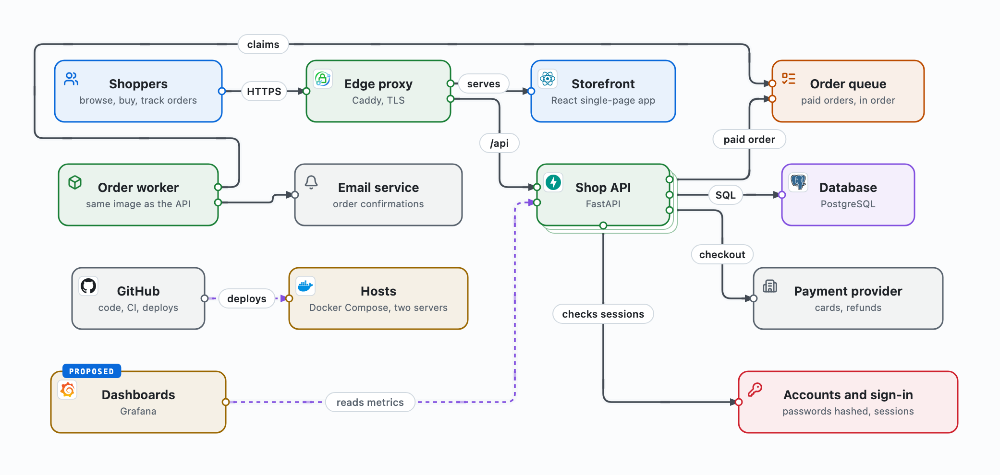

# umlimator

Layered, animated architecture maps you can click through, plus still pictures of each layer for documents that
cannot run a web page (a wiki such as Confluence, a slide deck). One JSON model in, one self-contained HTML page out.

umlimator is built on the `/visual` skill of [super-board](https://github.com/EricTechPro/super-board) by Eric Tech:
its renderer, viewer and layout check are copied unmodified and then patched (see [Credits](#credits)). The idea of
official brand marks on cards, and the script that fetches them, come from
[stack-diagram](https://github.com/caru-ini/stack-diagram) by caru-ini.



## What it gives you

- One self-contained HTML page per model: no build step, nothing loaded at runtime, works offline.
- Layers: a view per level (big picture, containers, components, flows); a stacked card opens its inner view with a
  double-click; breadcrumbs, Esc and the back button go up; `#view=<id>&node=<id>` deep-links.
- Animated flow along the lines (the ≋ button, paused and played with ❚❚), neighbours lit when you click a card,
  numbered steps in run-order views, minimap, ⌘K search, light and dark themes.
- A details panel per card: When to use, What it is, How it works and Behind the scenes, technology chips, and a
  badge (PROPOSED, TARGET, OFF ...) coloured by the status it names.
- Icons on cards: a product's official logo on a white tile, or a line icon for what the card is (a person, a
  server, a key), in one 16 px box where the kind sigil sits.
- A layout check: crossings, shared lines, labels on lines or box borders, text overflow, and names that touch a
  card's mark, per view.
- Stills: every view as SVG and PNG, light by default, for documents and slides.

## Use

```bash
python3 umlimator.py render examples/bookshop.json --out page.html   # the interactive page, then its check report
python3 umlimator.py stills page.html --out stills/                   # stills/<view>.svg and .png for every view
python3 umlimator.py stills page.html --out stills/ --views overview,api --scale 2 --theme light --reader
python3 umlimator.py check page.html --views 'pic-*'                   # the layout check on chosen views (a trailing * is a prefix)
python3 umlimator.py check page.html --ignore right-to-left           # leave a whole kind of finding out of the report
```

`model.json` follows `engine/references/schema.md` (§ Map model): shared `nodes` and `edges`, and `views` that each
show a subset, with optional `containers` (zone boxes), `layout` ([col, row] per node), `render: "sequence"` for
numbered run-order views, and inline view-local edges. `examples/bookshop.json` uses most of it.

Kinds for architecture maps: `frontend` (client / UI), `backend` (service / API), `ai` (agent / model), `database`,
`queue`, `security` (checks, secrets, identity), `cloud` (hosts, observability), `external` (outside the system),
`file`. super-board's skill-map kinds (`public`, `lane`, `script`, `hook`, `board`, `verb`) still work.

Needs Python 3.9+ (standard library only) and, for `stills` and `check`, Google Chrome or Chromium. The first render
that names a brand logo needs network access (see [Icons](#icons)).

## Icons

A node's `icon` names an entry in `icons/manifest.json`.

- **Line icons** ship in `icons/`: [Lucide](https://lucide.dev) (ISC; a few derive from Feather, MIT). They take the
  card's kind colour.
- **Brand logos are not shipped.** They are their owners' trademarks and several sources do not allow
  redistribution. The manifest records each logo's official source and a sha256. The first render that needs a logo
  downloads it into `~/.cache/umlimator/icons` (or `$UMLIMATOR_ICON_CACHE`) and uses it only if the hash matches, so
  a picture never changes because a source did. A logo is never recoloured.

Sources: [svgl](https://svgl.app), then [devicon](https://devicon.dev), then
[gilbarbara/logos](https://github.com/gilbarbara/logos), through stack-diagram's `tools/fetch_icons.py`;
Microsoft's [Azure](https://learn.microsoft.com/azure/architecture/icons/) and
[Entra](https://learn.microsoft.com/entra/architecture/architecture-icons) architecture icons; or a brand's own site.
Microsoft allows its icons in architecture diagrams, training material and documentation; follow each brand's
guidelines for anything else. Add an icon with:

```bash
python3 -I tools/fetch_icons.py icons "name:slug"            # a brand: svgl, then devicon, then gilbarbara/logos
python3 -I tools/fetch_icons.py icons "name=https://..."     # a brand's own official file
python3 -I tools/fetch_icons.py icons "name:lucide/<icon>"   # a line icon (lucide.dev/icons)
python3 umlimator.py pin-icons                                # records each new brand logo's sha256 and moves it out of icons/
```

## What was changed from super-board, and why

The upstream files are copied unmodified, then `patches/apply.py` edits `engine/assets/template.html` at exact anchors
(it stops if an anchor is missing, so an upstream change is never patched blind). The comments in `patches/apply.py`
give the reason for each of its 31 patches; the main ones:

1. `external` keeps its architecture meaning in map mode; upstream it became "External skill" with an author tag.
2. Architecture kinds get legend wording and appear in the legend.
3. A node's `badge` shows as the card's tab, coloured by the status it names, and in the details panel.
4. `#still=<view>&scale=N&theme=light` renders one view as a stand-alone SVG, which `umlimator.py stills` saves with
   headless Chrome.
5. A card name too wide for its card wraps onto two lines instead of ending in "…" (a still has no hover).
6. A line label with no free spot is placed anyway, never over a card; box titles are obstacles for lines and labels.
7. A line's own `style` (`emphasis`, `dashed`, `security`) wins over the map's colour by kind.
8. A view's `gap` and `rgap` set the space between columns and rows; `keepPairs` draws A→B and B→A as two lines; an
   edge's `fromSide` / `toSide` picks the sides its line uses.
9. `#check=1&views=a,pic-*` checks only those views, so a large model's chosen pictures check in seconds.
10. A node's `icon` draws a logo or a line icon in one 16 px box; every card keeps its name 36 px clear of the mark,
    and the check reports a name that touches it.

`render` skips upstream's layout search when every view already has a layout, and fails when the check did not
complete instead of reporting no problems.

Model fields umlimator adds: a node's `badge`, `icon` and `noSub` (name only, description in the panel); a view's
`gap`, `rgap` and `keepPairs`; an edge's `fromSide` and `toSide`.

The engine is super-board commit `d0b7d5a` (29 Oct 2026). To take a newer upstream version: copy
`skills/visual/assets/template.html`, `scripts/visual.py` and `references/` into `engine/`, run
`python3 -I patches/apply.py`, then render `examples/` and compare.

## Layout

```
umlimator.py                 CLI: render, stills, check, pin-icons
engine/assets/template.html  super-board /visual template, patched
engine/scripts/visual.py     super-board /visual renderer and checker (unmodified)
engine/references/           super-board's model schema and section guide (unmodified)
patches/apply.py             umlimator's template patches
icons/                       Lucide line icons and manifest.json (brand logos: sources and hashes only)
tools/fetch_icons.py         stack-diagram's icon fetcher (unmodified)
examples/                    a made-up bookshop: model, page and stills
LICENSE, LICENSE.super-board, LICENSE.stack-diagram, THIRD_PARTY_NOTICES.md
```

## Credits

- **[super-board](https://github.com/EricTechPro/super-board)** by Eric Tech, MIT (`LICENSE.super-board`). umlimator
  is a patched copy of its `/visual` skill (commit `d0b7d5a`): `engine/assets/template.html` (patched),
  `engine/scripts/visual.py` and `engine/references/` (unmodified). Its renderer, layered viewer, layout search and
  layout check are super-board's work.
- super-board's `/visual` in turn adapts ideas from **[BuilderIO/skills](https://github.com/BuilderIO/skills)** (MIT)
  and **[archify](https://github.com/tt-a1i/archify)** by tt-a1i, itself from
  **[Cocoon-AI/architecture-diagram-generator](https://github.com/Cocoon-AI/architecture-diagram-generator)** (MIT).
  No source file of either is copied; super-board's notices for both are kept in `THIRD_PARTY_NOTICES.md`.
- **[stack-diagram](https://github.com/caru-ini/stack-diagram)** by caru-ini, MIT (`LICENSE.stack-diagram`).
  `tools/fetch_icons.py` is copied unmodified (commit `75dbd3e`); the rules umlimator follows for logos (official marks
  only, never recoloured, on a white tile, fetched rather than bundled) are stack-diagram's.
- **[Lucide](https://lucide.dev)**, ISC, with icons derived from Feather, MIT: the line icons in `icons/`.

Details and full licence texts are in `THIRD_PARTY_NOTICES.md`. Brand names and logos are trademarks of their owners;
their use does not imply endorsement.

## Licence

umlimator's own code is MIT (`LICENSE`). The files from super-board and stack-diagram keep their MIT licences, and
the Lucide icons their ISC licence; keep `LICENSE.super-board`, `LICENSE.stack-diagram` and `THIRD_PARTY_NOTICES.md`
with any copy.
